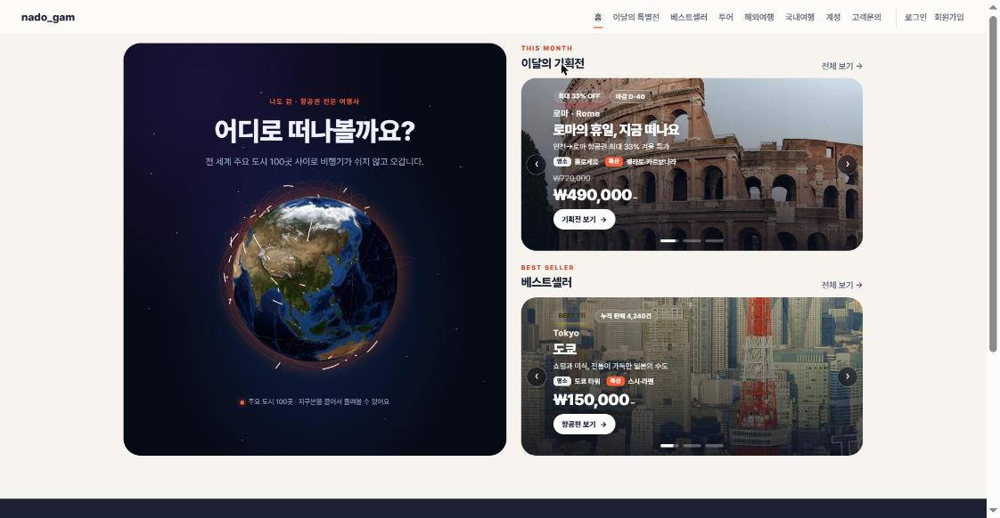
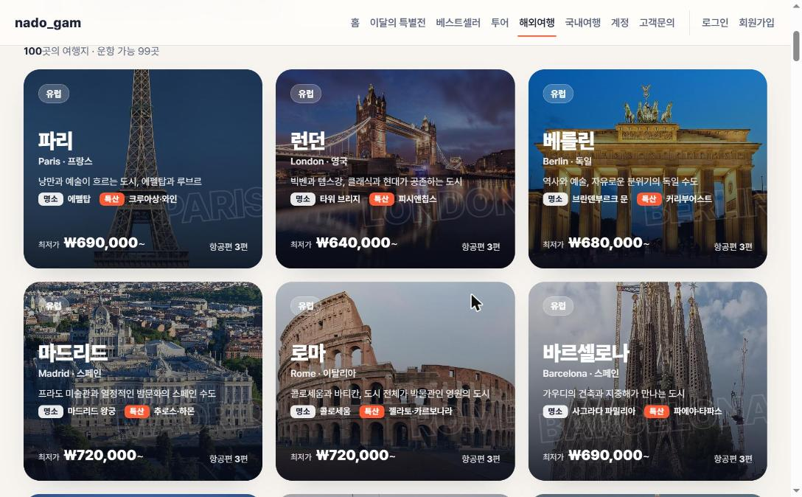
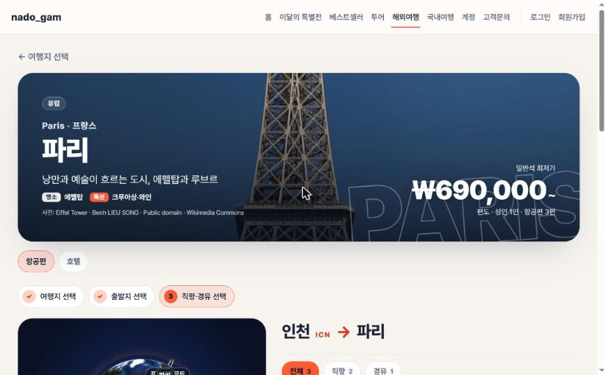
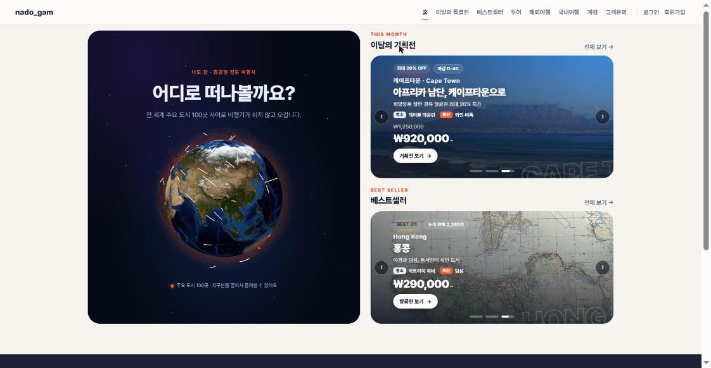
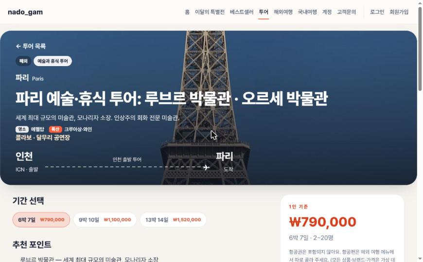
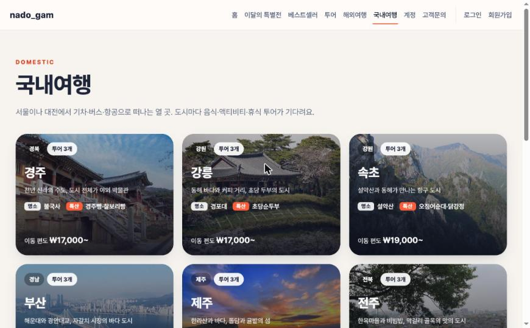
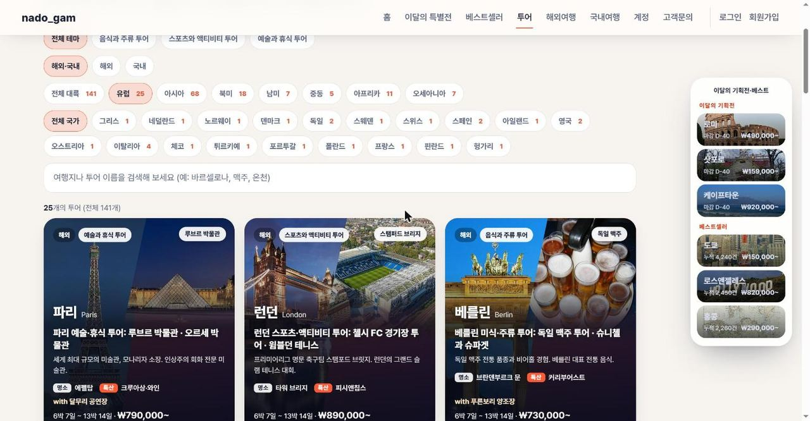

# 나도 감 (nado_gam)

> **"나도 갈래!"** — 가고 싶은 여행지를 고르면 항공편·투어·호텔·크루즈를 보여 주고, 비행 경로를 3D 지구본으로 보여 주는 여행사 웹 서비스입니다.
> 취업 포트폴리오로 만든 4차 개인 프로젝트이며, **모든 항공사·편명·호텔·투어 브랜드·가격은 가상 데이터**입니다.



## 한눈에 보기

| 항목 | 내용 |
|---|---|
| 개발 기간 | 2026.11.19 ~ 11.25 (1인 개발) |
| 한 줄 소개 | 지구본으로 노선을 보고, 항공편·투어·호텔·크루즈를 장바구니에 담아 모의 결제하는 여행사 웹 |
| 규모 | 해외 여행지 98곳(국내 도시 서울·부산 제외) · 항공편 304편 · 투어 139개 · 호텔 351개 · 크루즈 7곳 · 국내 도시 10곳(이동편 50개) |
| 품질 | 자동 테스트 168개 통과 |
| 문서 | [`nado_gam_word`](https://github.com/ho8566z/nado_gam_word) 레포: 기능정의서·DB설계서·더미데이터설계서, 엑셀 명세서(요구·기능·화면·API·테이블) |

## 주요 기능

**사용자**

- **메인**: 왼쪽에 도는 지구본(어느 방향으로 돌려도 관성으로 계속 회전), 오른쪽에 이달의 특별전·베스트셀러 캐로셀(좁은 화면에서는 위아래로 쌓임), 이벤트 팝업
- **해외 여행**: 여행지 선택(권역 탭·검색, 가격 낮은순·높은순·조회수순·인기순·여행사 추천순 정렬) → 출발지 선택 → 직항/경유·정렬 → 항공편 상세, 마우스를 올리면 지구본에 경로 강조
- **투어**: 해외 109개·국내 30개, 3테마(음식과 주류 / 스포츠와 액티비티 / 예술과 휴식), 대륙·국가 필터, 정렬(가격 낮은순·높은순·조회수순·인기순·여행사 추천순), 기간별 옵션과 일정. 카드는 왼쪽 여행지 전경 + 오른쪽 테마 사진(음식·경기장·명소)을 사선으로 나눠 보여 줍니다
- **국내여행**: 10개 도시, 서울·대전 출발 이동편(기차·버스·항공), 숙소·투어
- **호텔·크루즈**: 박수별 전체 가격, 크루즈 객실 가격
- **장바구니·모의 결제·내 예약**: 서버가 가격을 다시 계산하고, 결제하면 항공권 좌석이 줄어듭니다(부족하면 결제 전체 거절)
- **QR 코드**: 예약 확인(모바일 탑승권), 휴대폰으로 보기, 팝업 이벤트
- **고객문의**: 등록, 내 문의 목록, 관리자 답변
- **계정**: 회원가입·로그인, 정보 수정, 비밀번호 변경, 탈퇴
- **디자인**: 라이트 테마(포인트 `#ff5a36`, 보조 `#2f3dff`), 마스코트 '거코', 휴대폰에서는 하단 탭 바
- **서비스 느낌**: 4단 푸터(상품·고객센터·사업자 정보(예시))와 서비스 소개·이용약관·개인정보처리방침 화면, 스크롤을 따라다니는 기획전·베스트셀러 사이드바, 스크롤 시 카드가 떠오르는 효과(동작 줄이기 설정 존중)

**관리자** (`/admin`)

- 대시보드, 회원 이용 정지/해제
- 항공편·특별전·투어·호텔 등록·수정·삭제(삭제 탭에서 복구·영구 삭제)
- 여행지·도시·특별전·투어·호텔·크루즈 노출 중지/재개(작업 이력 기록)
- 팝업 관리, 문의 답변, 예약 체크인(예약 번호·QR 토큰)

## 화면

| | |
|---|---|
|  |  |
| 해외 여행지 98곳 카드 (대표 관광지 사진 · 명소/특산 · 정렬) | 여행지 상세와 항공편 선택 단계 |
|  |  |
| 메인의 캐로셀이 다음 장으로 넘어간 모습(기획전·베스트셀러는 자동으로 넘어감) | 투어 상세(기간별 옵션, 인천 출발 노선) |
|  |  |
| 국내여행 10개 도시 | 투어 목록: 대륙·국가 필터와 반분할 카드(여행지 전경 + 테마 사진) |

## 기술 스택

| 구분 | 사용 기술 |
|---|---|
| 백엔드 | Java 17, Spring Boot 4.1.2, Spring Security(BCrypt), Spring Data JPA(쓰기), Spring JDBC `JdbcClient`(읽기 조회) |
| 프론트엔드 | Thymeleaf(서버 렌더링), HTML/CSS/JavaScript, [globe.gl](https://globe.gl)(지구본, CDN) |
| DB | 로컬 H2(MySQL 호환 모드), 운영 MySQL 8 |
| 기타 | ZXing(QR 생성), Lombok, Gradle 9.8.2, JUnit 5 / Spring Boot Test |

## 실행 방법

필요한 것: **JDK 17** (그 밖에 설치할 것은 없습니다. 로컬은 H2 인메모리 DB를 씁니다.)

```bash
./gradlew bootRun        # Windows: gradlew.bat bootRun
```

브라우저에서 http://localhost:8080 을 엽니다. 시작할 때마다 `schema.sql`이 테이블을 다시 만들고 `data.sql`이 더미 데이터를 채웁니다.

```bash
./gradlew test           # 테스트 168개
```

**MySQL로 실행**

```bash
# 접속 정보는 환경변수로만 넘깁니다(코드·문서에 값을 쓰지 않습니다)
export DB_USERNAME=...  DB_PASSWORD=...  # DB_URL 은 선택(기본: localhost:3306/nadogam)
./gradlew bootRun --args='--spring.profiles.active=mysql'
```

> ⚠️ `schema.sql`이 시작할 때 테이블을 DROP 후 다시 만듭니다. 개발용 DB에서만 쓰세요.

**휴대폰으로 시연할 때 (QR)**

휴대폰에서 QR로 열려면 노트북의 와이파이 주소를 알려 줘야 합니다. 비워 두면 `localhost`가 들어가 휴대폰에서 열리지 않습니다.

```bash
export NADOGAM_PUBLIC_BASE_URL=http://192.168.0.10:8080   # 예시
```

> 지구본은 CDN에서 라이브러리와 지구 텍스처를 받아 오므로 시연 환경에 인터넷이 필요합니다.

## 프로젝트 구조

```
src/main/java/com/nadogam
├─ home · travel · special · bestseller   메인, 해외 여행(항공편), 이달의 특별전, 베스트셀러
├─ tour · domestic · stay                 투어, 국내여행, 호텔·크루즈
├─ cart · qr · support · popup            장바구니·결제·예약, QR, 고객문의, 이벤트 팝업
├─ auth · account                         회원가입·로그인, 계정
├─ admin                                  관리자 화면(회원·상품·노출·체크인)
├─ globe                                  지구본 경로 API(/api/globe/*, /api/travel/*)
└─ config · common                        보안 설정, 공통 변환(Fmt), 여행지 사진(DestPhotos)

src/main/resources
├─ schema.sql · data.sql                  테이블 정의와 더미 데이터(data.sql 은 스크립트로 생성)
├─ templates                              Thymeleaf 화면
└─ static                                 css, js, img/dest(여행지 사진·출처)
```

## 설계 포인트

- **관리자·사용자 분리**: 한 앱에서 `/admin/**` 경로를 따로 보호하고, 계정 테이블도 `member` / `admin_account`로 나눕니다.
- **여행지 먼저, 출발지는 뒤에**: 여행지를 고르면 그 여행지로 가는 항공편이 있는 출발지만 보여 줍니다(출발지는 항공편 데이터에서 조회).
- **서버가 가격을 계산**: 장바구니·결제의 가격은 클라이언트 값이 아니라 DB 값으로 다시 계산합니다.
- **좌석 차감은 조건부 UPDATE**: `seats_left >= 인원` 조건으로 한 번에 차감하고, 하나라도 부족하면 트랜잭션을 되돌립니다.
- **읽기/쓰기 분리**: 화면용 조회는 `JdbcClient` + `record`, 쓰기는 JPA로 작성합니다. 정렬·필터 값은 화이트리스트로 검증합니다.
- **비밀번호는 BCrypt**: 평문은 저장·로그·화면 어디에도 남기지 않습니다.
- **더미 데이터는 스크립트로 생성**: `nado_gam_word/design`의 파이썬 스크립트로 `data.sql`을 만들어 다시 만들 수 있습니다.

## 현재 한계와 2단계 계획

- 결제는 **모의 처리**입니다(실제 결제·카드 정보 수집 없음).
- 항공권 재고는 날짜별이 아니라 항공편 단위입니다.
- 댈러스 여행지 사진은 Wikipedia(댈러스 문서)에서 직접 내려받은 파일이라, 저작자·라이선스는 확인하지 못해 "Wikipedia 게재 이미지(미확인)"로 표기했습니다.

2단계에서 다룰 것: 날짜별 재고와 동시성 제어(낙관적 락, 동시 예약 테스트), 실제 결제 연동(테스트 모드), 동행 모집('나도 감'), 후기·찜, Redis 캐시, Docker·GitHub Actions 배포.

## 브랜치 전략

`main`(안정) · `dev`(통합) · `feature/*`(기능별). 새 기능은 `dev`에서 `feature/*`를 만들어 개발하고, `main`에서 직접 개발하지 않습니다.

## 사진·데이터 출처

- 여행지 대표 관광지 사진은 **Wikipedia·Wikimedia Commons**의 사진이며, 저작자와 라이선스(CC BY-SA 등)는 앱의 **푸터 → "여행지 사진 출처"**(`/photo-credits`)와 `src/main/resources/static/img/dest/credits.json`에 있습니다.
- 투어 카드 오른쪽의 테마 사진(음식·경기장·명소, 투어 139개)도 Wikipedia·Wikimedia Commons 사진이며, `/photo-credits`의 "투어 카드 테마 사진" 표와 `static/img/tour/credits.json`에 저작자·라이선스가 있습니다.
- 도시 특산물·관광지는 웹 조사를 참고만 했고, 이름·브랜드·가격·일정은 모두 가상입니다.
- 지구본 라이브러리([globe.gl](https://globe.gl))와 지구 텍스처 이미지(three-globe 예제 이미지)는 jsDelivr CDN에서 받아 옵니다.
